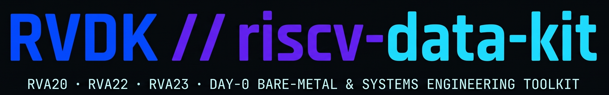

<div align="center">

  

  Idempotent Day-0 Bare-Metal Bootstrap, Multi-Layer Kernel Tuning, & Prebuilt Package Catalog for  
  **[RISC-V](https://riscv.org/) Data, Storage, Networking, and Edge AI Systems.**

</div>

---

The `riscv-data-kit` (**RVDK**) transforms out-of-the-box `riscv64` single-board computers and workstations into deterministic, headless Linux servers ready to get to work. 

* Vendor-isolated Board Support Package (BSP) guards
* Cached hardware/OS Kit discovery (`/etc/rvdk/kit.env`)
* Hardware Performance Monitoring Unit (PMU) counter exposure (`kptr_restrict = 1` safe default)
* Workload-aware `deeptune` profiles (`data`, `ai`)
* Board-specific hardware `quirk` toggles
* Metadata-driven host recovery media flashers (`SHA-256` verified)
* Native `4Kn` NVMe + Elastic LVM + Btrfs RAID 10 storage modules
* Precompiled [build catalog](https://github.com/drewv-labs/riscv-data-kit/releases) across **[SiFive](https://www.sifive.com/)**, **[Tenstorrent](https://tenstorrent.com/)**, **[StarFive](https://www.starfivetech.com/en/)**, **[Milk-V](https://milkv.io/)**, **[SpacemiT](https://www.spacemit.com/en/)**, **[UltraRISC](https://www.ultrarisc.com/)**, **[Banana Pi](https://www.banana-pi.org/)**, **[Firefly](https://www.t-firefly.com/pages/riscv)**, and **[Orange Pi](http://www.orangepi.org/)** platforms.

---

## Architectural Overview

Vendor RISC-V OS images frequently ship with desktop GUI bloat, background package timers, locked hardware performance counters, board-specific interrupt quirks, and fragile U-Boot or Device Tree Blob (DTB) hooks that break during standard `apt` upgrades. 

`RVDK` decouples bare-metal bring-up and service provisioning into independent, strictly idempotent layers dispatched via `/usr/local/bin/rvdk` or standalone `curl | sudo bash` endpoints:

### **Layer 1 — OS Normalization (`os/`):** 

Converges Debian, Ubuntu, Bianbu, and OpenWrt root filesystems into lean, headless server/router baselines. 

* Non-interactive operator account provisioning with SSH `authorized_keys` inheritance
* Optional `NOPASSWD` sudoers drop-in (`visudo -cf` verified)
* UTF-8 locales & RFC-1123 hostnames (systemd & OpenWrt UCI)
* Ubuntu/Bianbu `snapd` & GUI eradication with APT pin locks
* Reboot- & reload-persistent raw `nftables` prerouting + MPTCP kernel network hardening

---

### **Layer 2 — Silicon BSP, Quirks & Multi-Layer `DeepTune` (`bsp/` & `boards/`):** 

Organizes silicon hooks by SoC die (`bsp/<vendor>/<soc>/`) and board specifics (`boards/<vendor>/<board>/`). 

* Protects vendor `extlinux` and `zz-u-boot-menu` hooks (`--force-confdef` / `--force-confold`)
* Migrates stale factory APT snapshots onto signed HTTPS mirrors
* Masks unstable sleep targets & persists active SSH/wired NICs safely
* Unlocks hardware PMU counters (`kernel.perf_event_paranoid = -1`, `kernel.kptr_restrict = 1`)
* Toggles for board quirks (`hdmi`, `fusb`)
* Chains `os -> bsp -> board` kernel/IRQ/VM tuning (`--tune data|ai`) with bounded persistent `journald`

---

### **Layer 3 — Composable Data, Storage & Network Modules (`postgresql/`, `mods/`):** 

Self-contained, opt-in modules for: 

* `io_uring` PostgreSQL 18.6 (SHA-256 verified prebuilt `.tar.zst` bundle by default, or `--force-build` cold compilation)
* Native `4Kn` NVMe + Single/Dual-LVM (`vg_rvdk`) with OS/swap disk wipe guards
* Kernel Btrfs RAID 10
* Eclipse Mosquitto MQTT (loopback-safe by default; authenticated LAN bind)
* NFSv4 (explicit `--allow-cidr` / `--auto-subnet`, `root_squash` default, auto kernel `nfsd` -> userspace `nfs-ganesha`)
* `riscv64` Tailscale mesh VPN

---

## Supported Silicon Matrix

| Vendor | Model | Slug (`boards/`) | SoC Silicon (`bsp/`) | Core Complex | ISA Profile | Status |
| :--- | :--- | :--- | :--- | :--- | :--- | :--- |
| SiFive | HiFive Premier P550 | `sifive/p550` | `eswin/eic7700x` | 4x SiFive P550 (3-Wide OoO) | RVA20 + Zba/Zbb | Production |
| Milk-V | Megrez | `milkv/megrez` | `eswin/eic7700x` | 4x SiFive P550 (3-Wide OoO) | RVA20 + Zba/Zbb | Supported (P550 Proxy) |
| StarFive | VisionFive 2 | `starfive/vf2` | `starfive/jh7110` | 4x SiFive U74 (2-Wide InO) | RVA20 + Zba/Zbb | Production |
| StarFive | VisionFive 2 Lite | `starfive/vf2-lite` | `starfive/jh7110` | 4x SiFive U74 (2-Wide InO) | RVA20 + Zba/Zbb | Supported (VisionFive 2 Proxy) |
| SiFive | HiFive Unmatched Rev B | `sifive/unmatched` | `sifive/fu740` | 4x SiFive U74 (2-Wide InO) | RVA20 (`RV64GC`) | Planned / Supported (VisionFive 2 Proxy) |
| Milk-V | Mars | `milkv/mars` | `starfive/jh7110` | 4x SiFive U74 (2-Wide InO) | RVA20 + Zba/Zbb | Supported (VisionFive 2 Proxy) |
| Orange Pi | Orange Pi RV | `orangepi/rv` | `starfive/jh7110` | 4x SiFive U74 (2-Wide InO) | RVA20 + Zba/Zbb | Supported (VisionFive 2 Proxy) |
| Orange Pi | Orange Pi RV2 / R2S | `orangepi/rv2`, `orangepi/r2s` | `spacemit/k1` | 8x SpacemiT X60 (2-Wide InO) | RVA22 + RVV 1.0 | ActiveDev |
| Milk-V | Jupiter 1 | `milkv/jupiter` | `spacemit/k1` | 8x SpacemiT X60 (2-Wide InO) | RVA22 + RVV 1.0 | Planned / ActiveDev (OPi RV2 Proxy) |
| Banana Pi | BPI-F3 | `bananapi/f3` | `spacemit/k1` | 8x SpacemiT X60 (2-Wide InO) | RVA22 + RVV 1.0 | ActiveDev (OPi RV2 proxy) |
| Banana Pi | BPI-CM6 | `bananapi/cm6` | `spacemit/k1` | 8x SpacemiT X60 (2-Wide InO) | RVA22 + RVV 1.0 | ActiveDev (OPi RV2 proxy) |
| Milk-V | Titan | `milkv/titan` | `ultrarisc/dp1000` | 8x UltraRISC CP100 (4-Wide OoO) | RVA22 + H-Ext 1.0 | EnRoute |
| Milk-V | Jupiter 2 | `milkv/jupiter2` | `spacemit/k3` | 8x SpacemiT X100 (4-Wide OoO) | RVA23 + RVV 1.0 | Planned |
| Firefly | AIBOX-K3 | `firefly/aibox-k3` | `spacemit/k3` | 8x SpacemiT X100 (4-Wide OoO) | RVA23 + RVV 1.0 | Planned (Jupiter 2 proxy) |
| Tenstorrent | Atlantis | `tenstorrent/atlantis` | `tenstorrent/atlantis` | 8x Tenstorrent Ascalon-X (Wide OoO) | RVA23 + RVV 1.0 | Planned |

---

**Matrix Status Legend**

| Status | Desc |
| :--- | :--- |
| Production | Fully tested on in-house silicon; Hard Verification |
| Supported | Fully tested on proxy node; Soft Verification; e.g. Milk-V Megrez shares same architecture as P550 which has been Hard Verified as Production node; Will move to "Production" with evidence of Hard Verification |
| ActiveDev | Board is on hand and actively working through dev & test process; Will get moved to "Production" once completed |
| EnRoute | Board is ordered and waiting on shipping; Moves to "ActiveDev" upon delivery |
| Planned | On the roadmap but have yet to secure a board or suitable proxy |

---

## Quickstart Usage

### 1. Day-0 Bare-Metal Bootstrap (Auto-Detects Board, SoC & OS)

Boot a freshly flashed RISC-V board and run `bootstrap.sh` to install the `rvdk` CLI (`~/.rvdk/engine` -> `/usr/local/bin/rvdk`), cache `/etc/rvdk/kit.env`, and converge both Layer 1 (`os/`) and Layer 2 (`bsp/`):

```bash
curl -fsSL https://rvdk.drewv-labs.dev/bootstrap.sh | sudo bash -s -- --user rvadmin --hostname rv-p550 --nopasswd
```

Or install the `rvdk` CLI first and invoke only the specific primitives you need:

```bash
curl -fsSL https://rvdk.drewv-labs.dev/install-cli.sh | sudo bash

rvdk kit                                                 # Inspect resolved Board/SoC/OS Kit & DeepTune chain
sudo rvdk os --user rvadmin --hostname rv-vf2 --nopasswd # OS normalization only
sudo rvdk bsp                                            # Silicon BSP & PMU unlock only
sudo rvdk deeptune --tune data                           # Multi-layer kernel tuning (data | ai)
rvdk quirk list                                          # List & toggle board hardware quirks (e.g. hdmi, fusb)
```

---

### 2. A-La-Carte Storage, Database & Network Modules

Every Layer 3 module runs standalone—accepting explicit CLI flags or optional key-value defaults from `/etc/rvdk/config.env` / `~/.rvdk/config.env` (`RVDK_ENV_FILE`):

```bash
# Format secondary NVMe to native 4Kn (4096B) sectors + LVM (vg_rvdk/lv_data) + XFS/ext4/Btrfs
sudo rvdk mods/nvme-4kn --device /dev/nvme0n1 --mount /mnt/nvme_data

# Inspect or grow/autotune live LVM volumes online without downtime
sudo rvdk storage status
sudo rvdk storage grow --lv lv_data --gb 50

# Install silicon-tuned PostgreSQL 18.6 with io_uring & Sv39 HugePages (prebuilt .tar.zst default)
sudo rvdk postgresql --data-mount /mnt/nvme_data

# Or force a reproducible cold source compile on-device
sudo rvdk postgresql --force-build

# Optional storage & network modules
sudo rvdk mods/btrfs-raid --json '[...]'
sudo rvdk mods/mosquitto --port 1883
sudo rvdk mods/nfs-vault --allow-cidr 192.168.1.0/24
sudo rvdk mods/tailscale --up --ssh
```

You can also invoke any module directly inside an external CI/CD script without installing the full CLI:

```bash
curl -fsSL https://rvdk.drewv-labs.dev/postgresql/latest/forge.sh | sudo bash
```

---

### 3. Host Recovery Media Flashers (macOS Zsh & Linux Bash supported)

Install `rvdk` on a macOS or Linux workstation to pull, `SHA-256` verify, cache (`~/.rvdk/cache/`), and flash vendor recovery media with hardware safety interlocks (blocking internal/OS drives, non-removable Linux disks, and drives `>256 GiB`):

```bash
rvdk flash list
rvdk flash vf2 sd 4                                      # Flash StarFive VisionFive 2 SD card (/dev/disk4)
rvdk flash p550 usb 4                                    # Stage U-Boot ext4 recovery USB for HiFive Premier P550
rvdk flash p550 usb --device /dev/sdX --image /path/to/custom.img.zst --sha256 <hex64>
```

---

## Repository Structure

```text
riscv-data-kit/
├── README.md
├── LICENSE
├── bootstrap.sh                          # Universal dispatcher & `/usr/local/bin/rvdk` CLI entrypoint
├── install-cli.sh                        # Clones ~/.rvdk/engine, caches /etc/rvdk/kit.env & links `rvdk`
├── lib/
│   ├── common.sh                         # Safe non-executing .env parser/writer, validators & logging
│   ├── kit.sh                            # Hardware/OS Kit inference & <1ms /etc/rvdk/kit.env cache
│   ├── bsp.sh                            # Shared Silicon BSP helpers (dpkg guard, NIC, PMU, cpufreq)
│   ├── storage_guard.sh                  # Destructive block device & OS/swap disk safety interlocks
│   ├── flash.sh                          # Metadata-driven macOS/Linux removable media flasher
│   ├── apt.sh                            # Idempotent APT lock/stamp & single-pass update helper
│   └── progbar.sh                        # Persistent VT100 bottom progress bar (standalone or stacked)
├── os/
│   ├── bootstrap-apt.sh                  # Unified Debian/Ubuntu/Bianbu Day-0 engine & nftables guard
│   ├── bootstrap-debian.sh               # Layer 1A: Headless Debian Day-0 wrapper
│   ├── bootstrap-ubuntu.sh               # Layer 1B: Headless Ubuntu Day-0 wrapper
│   ├── bootstrap-bianbu.sh               # Layer 1C: Headless SpacemiT Bianbu OS Day-0 wrapper
│   ├── bootstrap-openwrt.sh              # Layer 1D: OpenWrt UCI hostname & fw4/procd router guard
│   └── deeptune.sh                       # Layer 1 DeepTune: Persistent journald, THP, VM & scheduler
├── bsp/
│   ├── eswin/                            # Layer 2: EIC7700X DTB guard, end0 netplan, PWM fan, P550 PMU & DeepTune
│   ├── sifive/                           # Layer 2: SiFive Freedom U740 (4x U74) BSP
│   ├── starfive/                         # Layer 2: JH7110 U-Boot guard, signed HTTPS repo migration & U74 PMU
│   ├── spacemit/                         # Layer 2: SpacemiT K1/M1 (RVA22) & K3 (RVA23) RVV 1.0 BSPs
│   ├── ultrarisc/                        # Layer 2: UltraRISC UR-DP1000 (8x CP100 OoO + PCIe Gen4 x16) BSP
│   └── tenstorrent/                      # Layer 2: Tenstorrent Atlantis (8x Ascalon-X RVA23 OoO) BSP
├── boards/
│   ├── sifive/                           # Media manifests, P550 flash-usb.sh, board deeptune.sh & quirks/
│   ├── starfive/                         # Media manifests & VF2 flash-sd.sh block image flasher
│   ├── milkv/                            # Media manifests (Milk-V Jupiter 1/2, Mars, Megrez & Titan)
│   ├── bananapi/                         # Media manifests (Banana Pi BPI-F3 & BPI-CM6)
│   ├── orangepi/                         # Media manifests (Orange Pi RV, RV2 & R2S)
│   ├── firefly/                          # Media manifest (Firefly AIBOX-K3 Edge Mini PC)
│   └── tenstorrent/                      # Media manifest (Tenstorrent Atlantis)
├── postgresql/
│   ├── 18-6-io_uring/forge.sh            # Module: PostgreSQL 18.6 (io_uring + Sv39 HugePages; prebuilt or --force-build)
│   └── latest/forge.sh                   # Dispatcher alias -> 18-6-io_uring
├── mods/
│   ├── nvme-4kn/                         # Module: Native 4Kn LBA format + Single/Dual-LVM (vg_rvdk) + XFS/Btrfs
│   ├── btrfs-raid/                       # Module: Declarative native kernel Btrfs RAID 10 builder
│   ├── mosquitto/                        # Module: Eclipse Mosquitto MQTT (:1883 + Unix domain socket)
│   ├── nfs-vault/                        # Module: NFSv4 exporter (auto kernel nfsd -> userspace NFS-Ganesha)
│   └── tailscale/                        # Module: Static riscv64 Tailscale mesh VPN + optional userspace netstack
├── utils/
│   ├── storage.sh                        # Live online LVM grow, Btrfs shrink & priority-weighted autotuner
│   └── purge-user.sh                     # Safe factory user state migration, UID re-own & account purge
└── tools/
    └── rvdk_ci.py                        # Manifest schema validator, security scanner & static Pages bundler
```


---

## Ecosystem & Community Links

#### Related *DREW-V Labs* Projects
- [BrakerRak — Stateful RISC-V Execution & Benchmarking Harness (Built on RVDK)](https://github.com/drewv-labs/brakerrak)
- [CarrierPigeons — Continuous Telemetric Documentation (CTD) Engine](https://github.com/drewv-labs/carrierpigeons)

#### Orgs & Special Projects
- [RISC-V International](https://riscv.org/)
- [RISE Project (RISC-V Software Ecosystem)](https://riseproject.dev/)
- [Linux Foundation](https://www.linuxfoundation.org/)

#### Industry
- [SiFive](https://www.sifive.com/)
- [Tenstorrent](https://tenstorrent.com/en)
---
- [Milk-V](https://milkv.io/)
- [SpacemiT](https://www.spacemit.com/)
- [StarFive](https://www.starfivetech.com/en/)
- [UltraRISC](https://ultrarisc.com/en/)
---
- [BananaPi](https://banana-pi.org/)
- [Firefly RISC-V](https://www.t-firefly.com/pages/riscv)
- [OrangePi RISC-V](https://orangepi.net/shop.html?tag=risc-v)

#### Software
- [PostgreSQL 18.6 Release Notes (`io_uring`)](https://www.postgresql.org/docs/18/release-18-6.html)
- [NFS-Ganesha](https://github.com/nfs-ganesha/nfs-ganesha)
- [MQTT](https://mqtt.org/)
- [Eclipse Mosquitto](https://mosquitto.org/)
- [BTRFS RAID](https://btrfs.readthedocs.io/en/latest/Volume-management.html)

---

<div align="center">

**[DREW-V Labs](https://github.com/drewv-labs)** // **Drew Vandagriff** — *Dallas, TX*  
`Simplicity in Architecture · Efficiency in Engineering · Purity in Science · Audacity in Art · Life in Logic`

</div>


---

###### Trademarks & Non-Affiliation Notice
> **RVDK** (`riscv-data-kit`) is an independent open-source project developed and maintained by **DREW-V Labs** and is not affiliated with, endorsed by, or sponsored by **RISC-V International**, the **Linux Foundation**, the **RISE Project**, **SiFive**, **Tenstorrent**, **StarFive**, **Milk-V**, **SpacemiT**, **UltraRISC**, **Banana Pi**, **Firefly**, or **Orange Pi**. "RISC-V" is a registered trademark of RISC-V International. All other product names, logos, and brands are property of their respective owners and are used strictly for identification and hardware compatibility purposes under nominative fair use.
