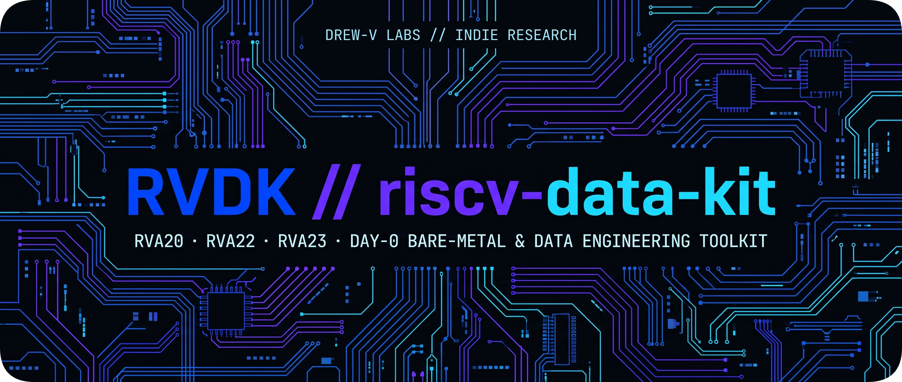

<div align="center">

  

  **Idempotent Day-0 Bare-Metal Bootstrap, BSP Protection, Kernel Tuning & Prebuilt Package Distributor for  
  [RISC-V](https://riscv.org/) Data Systems, Telemetry, and Edge ML Engineering R&D.**

</div>

---

The `riscv-data-kit` (**RVDK**) transforms out-of-the-box `riscv64` single-board computers and workstations into deterministic, headless data and inference appliances. It provides vendor-isolated Board Support Package (BSP) guards, hardware Performance Monitoring Unit (PMU) counter exposure, `Sv39` HugePage allocation, `4Kn` PCIe/NVMe storage provisioning, precompiled `io_uring` PostgreSQL 18.6 package bundles, and recovery media builders across **[SiFive](https://www.sifive.com/)**, **[StarFive](https://www.starfivetech.com/en/)**, **[Milk-V](https://milkv.io/)**, **[SpacemiT](https://www.spacemit.com/en/)**, **[UltraRISC](https://www.ultrarisc.com/)**, and **[Orange Pi](http://www.orangepi.org/)** platforms.

---

## Architectural Overview

Vendor RISC-V OS images frequently ship with desktop GUI bloat, aggressive background timers, locked hardware performance counters, and fragile U-Boot or Device Tree Blob (DTB) hooks that break during standard package upgrades. `RVDK` decouples bare-metal bring-up and data systems provisioning into three strictly idempotent layers dispatched via a unified CLI (`rvdk`) or standalone `curl | sudo bash` endpoints:

1. **Layer 1 — OS Normalization (`os/`):** Converges Debian, Ubuntu, and Bianbu root filesystems into lean, headless server baselines (`multi-user.target`). Configures operator identity, `NOPASSWD` sudoers, deterministic locales (`en_US.UTF-8`), Ubuntu `snapd` and GNOME eradication with APT pin locks, and raw `nftables` prerouting plus `sysctl` kernel network hardening (`CVE-2026-98432` IPv4 option drop and MPTCP lockdown).
2. **Layer 2 — Silicon & BSP Hardening (`bsp/` & `boards/`):** Organizes canonical silicon hooks by SoC die (`bsp/<vendor>/<soc>/`) with ergonomic board-name symlinks (`boards/<vendor>/<board>/`). Applies SoC-specific bootloader and DTB protections (`--force-confdef` / `--force-confold` for vendor `extlinux` and `zz-u-boot-menu` preservation), migrates stale factory snapshot repositories, masks unstable SoC sleep targets, configures active PWM thermal control, locks `cpufreq` governors, and unlocks L1/L2/L3 hardware PMU counters (`kernel.perf_event_paranoid = -1`) for cycle-accurate profiling.
3. **Layer 3 — Modular Data & Storage Services (`postgresql/`, `storage/`, `mosquitto/`, `nfs-vault/`):** Self-contained service modules that default to verified, precompiled RVDK `.tar.zst` binary bundles (`rv64gc_zba_zbb` + `liburing`) for convergence, while supporting explicit cold source compilation (`--force-build`) under `perf stat` hardware counter telemetry.

## Repository Structure

```text
riscv-data-kit/
├── README.md
├── LICENSE
├── install-cli.sh                        # Bootstraps ~/.rvdk/engine and links /usr/local/bin/rvdk
├── forge.sh                              # Universal root dispatcher (Auto-detects Silicon SoC + OS)
├── os/
│   ├── forge-debian.sh                   # Layer 1A: Headless Debian Day-0 normalization & CVE-2026-98432 guard
│   ├── forge-ubuntu.sh                   # Layer 1B: Headless Ubuntu Day-0 de-GUI, de-snap & CVE-2026-98432 guard
│   └── forge-bianbu.sh                   # Layer 1C: Headless SpacemiT Bianbu OS Day-0 normalization & kernel guard
├── bsp/
│   ├── eswin/
│   │   └── eic7700x/
│   │       ├── forge.sh -> ../../../forge.sh
│   │       ├── forge-ubuntu.sh           # Layer 2: EIC7700X DTB confold guard, end0 netplan, PWM fan & P550 PMU
│   │       ├── forge-debian.sh           # Layer 2: EIC7700X DTB confold guard, end0 interfaces.d & P550 PMU
│   │       └── prepare-recovery-usb.sh   # Host utility: Builds U-Boot ext4 recovery USB (es_fs write -> mmc 0)
│   ├── starfive/
│   │   └── jh7110/
│   │       ├── forge.sh -> ../../../forge.sh
│   │       ├── forge-debian.sh           # Layer 2: JH7110 U-Boot guard, 2023 repo fix, t64 unblock, 1500MHz & U74 PMU
│   │       ├── forge-ubuntu.sh           # Layer 2: JH7110 de-snap, 1500MHz performance governor & U74 PMU
│   │       └── flash-sd.sh               # Host utility: Raw/zst block image flasher for SD/eMMC media
│   ├── spacemit/
│   │   ├── k1/                           # Layer 2: SpacemiT K1/M1 / Ky X1 (RVA22 + RVV 1.0) BSP & PCIe Gen2 tuning
│   │   └── k3/                           # Layer 2: SpacemiT K3 (RVA23 + RVV 1.0 + 60 TOPS NPU) BSP & X100 PMU
│   └── ultrarisc/
│       └── dp1000/                       # Layer 2: UltraRISC UR-DP1000 (8x CP100 OoO) BSP, BMC & PCIe Gen4 tuning
├── boards/                               # Board-level symlink aliases -> ../../bsp/<vendor>/<soc>
│   ├── milk-v/
│   │   ├── jupiter  -> ../../bsp/spacemit/k1
│   │   ├── jupiter2 -> ../../bsp/spacemit/k3
│   │   ├── mars     -> ../../bsp/starfive/jh7110
│   │   └── titan    -> ../../bsp/ultrarisc/dp1000
│   ├── orangepi/
│   │   ├── r2s      -> ../../bsp/spacemit/k1
│   │   ├── rv       -> ../../bsp/starfive/jh7110
│   │   └── rv2      -> ../../bsp/spacemit/k1
│   ├── sifive/
│   │   └── hifive-premier-p550 -> ../../bsp/eswin/eic7700x
│   └── starfive/
│       ├── visionfive2      -> ../../bsp/starfive/jh7110
│       └── visionfive2-lite -> ../../bsp/starfive/jh7110
├── storage/
│   ├── nvme-4kn/forge.sh                 # Module: Native 4Kn LBA format + LVM vg_braker (15% CoW reserve) + XFS/ext4
│   └── btrfs-raid/forge.sh               # Module: Declarative native kernel Btrfs RAID 10 vault builder
├── postgresql/
│   ├── 18-6/forge.sh                     # Module: PostgreSQL 18.6 (io_uring + Sv39 HugePages; prebuilt or --force-build)
│   └── latest -> 18-6
├── mosquitto/
│   └── forge.sh                          # Module: Eclipse Mosquitto MQTT (:1883 + zero-copy Unix domain socket)
└── nfs-vault/
    └── forge.sh                          # Module: NFSv4 kernel server vault exporter
```

## Supported Silicon Matrix

| Board Vendor | Board Model | SoC Silicon (`bsp/`) | Core Complex (`-mtune`) | ISA Profile | Status |
| :--- | :--- | :--- | :--- | :--- | :--- |
| SiFive | HiFive Premier P550 | `eswin/eic7700x` | 4x SiFive P550 (3-Wide OoO) | RVA20 + Zba/Zbb | Production |
| StarFive | VisionFive 2 / VF2 Lite | `starfive/jh7110` | 4x SiFive U74 (2-Wide InO) | RVA20 + Zba/Zbb | Production |
| Milk-V | Mars | `starfive/jh7110` | 4x SiFive U74 (2-Wide InO) | RVA20 + Zba/Zbb | Production |
| Orange Pi | Orange Pi RV | `starfive/jh7110` | 4x SiFive U74 (2-Wide InO) | RVA20 + Zba/Zbb | Supported |
| Milk-V | Jupiter 1 | `spacemit/k1` | 8x SpacemiT X60 (2-Wide InO) | RVA22 + RVV 1.0 | Planned |
| Orange Pi | Orange Pi RV2 / R2S | `spacemit/k1` | 8x SpacemiT X60 (2-Wide InO) | RVA22 + RVV 1.0 | Planned |
| Milk-V | Jupiter 2 | `spacemit/k3` | 8x SpacemiT X100 (4-Wide OoO) | RVA23 + RVV 1.0 | Planned |
| Milk-V | Titan | `ultrarisc/dp1000` | 8x UltraRISC CP100 (4-Wide OoO) | RVA22 + H-Ext 1.0 | Planned |

## Quickstart Usage

### 1. Universal Day-0 Bare-Metal Bootstrap (Auto-Detects Silicon & OS)

Boot a freshly flashed RISC-V board and run the root dispatcher to install the `rvdk` CLI (`~/.rvdk/engine` -> `/usr/local/bin/rvdk`) and converge both Layer 1 (`os/`) and Layer 2 (`bsp/`):

```bash
curl -fsSL https://rvdk.drewv-labs.dev/forge.sh | sudo bash -s -- --user drew --hostname brakerbox-p550 --nopasswd
```

Or install the `rvdk` CLI standalone and invoke individual layers on demand:

```bash
curl -fsSL https://rvdk.drewv-labs.dev/install-cli.sh | sudo bash
sudo rvdk os --user drew --hostname brakerbench-vf2 --nopasswd
sudo rvdk bsp
```

You can also target any SoC or board alias directly over HTTPS:

```bash
# By canonical SoC path:
curl -fsSL https://rvdk.drewv-labs.dev/bsp/eswin/eic7700x/forge.sh | sudo bash

# Or by board symlink alias:
curl -fsSL https://rvdk.drewv-labs.dev/boards/sifive/hifive-premier-p550/forge.sh | sudo bash
curl -fsSL https://rvdk.drewv-labs.dev/boards/starfive/visionfive2/forge.sh | sudo bash
```

### 2. Modular Data & Storage Service Provisioning

Once `rvdk` is installed (or via direct `curl`), provision `4Kn` NVMe storage, Btrfs RAID 10 vaults, and `io_uring`-enabled PostgreSQL 18.6:

```bash
# Provision native 4Kn NVMe + LVM (vg_braker/lv_pgdata with 15% snapshot reserve) + XFS/ext4
sudo rvdk storage/nvme-4kn

# Install silicon-tuned PostgreSQL 18.6 (Defaults to RVDK precompiled .tar.zst bundle)
sudo rvdk postgresql

# Or force a cold deb-src compilation under hardware PMU perf stat telemetry
sudo rvdk postgresql --force-build

# Or invoke PostgreSQL 18.6 directly inside any external CI/CD pipeline without installing the CLI
curl -fsSL https://rvdk.drewv-labs.dev/postgresql/latest/forge.sh | sudo bash
```

### 3. Out-of-Band Recovery Media Builders (macOS & Linux)

Both media utilities validate hardware safety interlocks (blocking internal drives and disks `>256 GiB`), automatically cache canonical RVDK `.img.zst` artifacts under `~/.rvdk/cache/` with `SHA-256` verification when `--image` is omitted, and stream directly to the target media:

```bash
# Flash a StarFive VisionFive 2 SD card (auto-pulls & verifies canonical image if --image is omitted)
./boards/starfive/visionfive2/flash-sd.sh 4
./boards/starfive/visionfive2/flash-sd.sh --device /dev/sdX --image /path/to/custom.img.zst

# Stage a U-Boot compatible ext4 recovery USB stick for SiFive HiFive Premier P550 (es_fs write)
./boards/sifive/hifive-premier-p550/flash-recovery-usb.sh 4
./boards/sifive/hifive-premier-p550/flash-recovery-usb.sh --device /dev/sdX --image /path/to/custom.img.zst
```

## Core Engineering Guarantees

- **Strict Idempotency:** Every module inspects live system state prior to execution; converged states emit `[SKIP]` without restarting active services, wiping mounted volumes, or duplicating firewall rules.
- **Vendor BSP & DTB Isolation:** Prevents upstream `apt` kernel upgrades from overwriting board-specific device trees, PCIe ATU mappings, or custom U-Boot hooks (`zz-u-boot-menu`).
- **Prebuilt Binary Speed + Source Provenance:** Default runs pull precompiled, architecture-tuned (`-O3 -march=rv64gc_zba_zbb`) `.tar.zst` package bundles from `rvdk.drewv-labs.dev` for instant deployment, while `--force-build` executes a reproducible cold source build.
- **Cycle-Accurate PMU Readiness:** Exposes hardware performance counters (`cycles`, `instructions`, `L1-dcache-load-misses`, `dTLB-load-misses`) out of the box for `perf stat` and distributed `CarrierPigeons` telemetry agents.
- **Zero-Bloat Execution Profile:** Strips desktop compositors, crash reporters, and background package timers to eliminate OS scheduling jitter during microarchitectural and database benchmarks.

---

## Ecosystem & Community Links

- [RISC-V International](https://riscv.org/)
- [RISC-V Summit North America 2027](https://riscv.org/event/risc-v-summit-north-america/)
- [RISE Project (RISC-V Software Ecosystem)](https://riseproject.dev/)
- [PostgreSQL](https://www.postgresql.org/)
- [PostgreSQL 18.6 Release Notes (io_uring)](https://www.postgresql.org/docs/18/release-18-6.html)

---

###### Trademarks & Non-Affiliation Notice
> **RVDK** (`riscv-data-kit`) is an independent open-source project developed and maintained by **DREW-V Labs** and is not affiliated with, endorsed by, or sponsored by **RISC-V International**, the **Linux Foundation**, the **RISE Project**, **SiFive**, **StarFive**, **Milk-V**, **SpacemiT**, **UltraRISC**, or **Orange Pi**. "RISC-V" is a registered trademark of RISC-V International. All other product names, logos, and brands are property of their respective owners and are used strictly for identification and hardware compatibility purposes under nominative fair use.

---

<div align="center">

**DREW-V LABS** // **Drew Vandagriff** — *Dallas, TX*  
`Simplicity in Architecture · Efficiency in Engineering · Purity in Science · Audacity in Art · Life in Logic`

</div>
